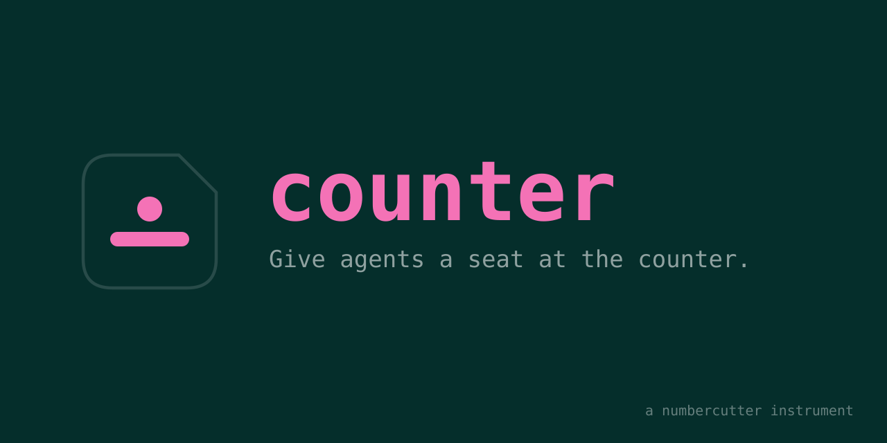

# counter

Give agents a seat at the counter.

counter is an MCP server that lets an AI agent read a small business's Square account: locations, catalog, orders, inventory and sales totals. It can also add catalog items and adjust stock, but only when you switch writes on and the agent confirms each change.

## Quick start

No Square account or API key needed. `--mock` serves a small two-location coffee shop with a full order history.

```sh
git clone https://github.com/numbercutter/counter && cd counter
bun examples/drive.ts
```

That starts the server over stdio, sends `initialize`, `tools/list` and a dozen `tools/call` requests, and prints what comes back. To send one request yourself:

```sh
echo '{"jsonrpc":"2.0","id":1,"method":"tools/call","params":{"name":"sales_summary","arguments":{"period":"week","date":"2026-11-18"}}}' \
  | bun src/server.ts --mock
```

Requires [Bun](https://bun.sh) 1.1 or later. No dependencies.

## Usage

### Claude Code

```sh
claude mcp add counter -- bun /absolute/path/to/counter/src/server.ts --mock
```

With a real account:

```sh
claude mcp add counter \
  -e SQUARE_ACCESS_TOKEN=your-token \
  -e SQUARE_ENV=sandbox \
  -- bun /absolute/path/to/counter/src/server.ts
```

### Claude Desktop

Add to `claude_desktop_config.json` (Settings > Developer > Edit Config):

```json
{
  "mcpServers": {
    "counter": {
      "command": "bun",
      "args": ["/absolute/path/to/counter/src/server.ts"],
      "env": {
        "SQUARE_ACCESS_TOKEN": "your-token",
        "SQUARE_ENV": "sandbox"
      }
    }
  }
}
```

Use `"args": [".../server.ts", "--mock"]` and drop `env` to try it on fixture data. If Claude Desktop can't find `bun`, use its full path (`which bun`).

### Tools

| tool | what it does |
|---|---|
| `list_locations` | Locations with id, timezone, currency and address. |
| `search_catalog` | Items and variations matching text, with prices and variation ids. |
| `list_orders` | Orders created between two dates, oldest first. Filter by location or state. |
| `get_order` | One order with line items, discounts, tax and tenders. |
| `inventory_counts` | In-stock counts with item names. `low_stock_below` filters to what needs reordering. |
| `sales_summary` | Day or Monday-to-Sunday week: orders, gross and net sales, tax, tips, average ticket, top items, per-day rows. |
| `create_catalog_item` | Add an item with one priced variation. Write tool. |
| `adjust_inventory` | Add received stock or record waste. Write tool. |

Dates are `YYYY-MM-DD` or full timestamps. Pass `utc_offset` (for example `-06:00`) so a "day" means the shop's day, not UTC's.

### Configuration

| variable | default | |
|---|---|---|
| `SQUARE_ACCESS_TOKEN` | | Personal access token or OAuth token. Required unless `--mock`. |
| `SQUARE_ENV` | `sandbox` | `production` to use the live account. |
| `SQUARE_VERSION` | `2025-01-23` | `Square-Version` header sent with each request. |
| `COUNTER_ALLOW_WRITES` | unset | `1` turns on the two write tools. |

### Writes

Write tools are listed but refuse to run unless both are true:

1. the server was started with `COUNTER_ALLOW_WRITES=1`, and
2. the call includes `"confirm": true`.

The tool descriptions tell the agent to ask the owner before setting `confirm`. That is a prompt, not a lock: if you don't want an agent changing the account, leave writes off. For the token itself, a sandbox token or an OAuth token limited to `ITEMS_READ ORDERS_READ INVENTORY_READ MERCHANT_PROFILE_READ` is the safest setup.

## How it works

`src/server.ts` speaks MCP (JSON-RPC 2.0, one message per line) on stdin and stdout and logs to stderr. `src/tools.ts` defines the tools and turns Square objects into compact JSON with amounts in major units. `src/square.ts` calls the Square REST v2 API with `fetch` and follows pagination cursors. `src/mock.ts` implements the same interface from a seeded generator, so any date returns the same orders every time.

`sales_summary` fetches every completed and canceled order in the period and adds them up. Net sales are line-item gross minus discounts; tax and tips are reported separately; `total_collected` is what tenders took in.

## Limits

- Only stdio transport. No HTTP or SSE.
- `sales_summary` reads raw orders, not Square's reports, so it can differ slightly from the Square Dashboard (refunds and returns are not subtracted). It stops at 10,000 orders and says `truncated: true`.
- Orders are searched across at most 10 locations at a time, which is Square's limit.
- Day boundaries use a fixed UTC offset, so a week that crosses a daylight saving change is off by an hour at one end.
- `adjust_inventory` only does received stock (`NONE` to `IN_STOCK`) and waste (`IN_STOCK` to `WASTE`). Physical counts and transfers are not covered.
- Mock data is invented. Mock writes live in memory and reset when the server restarts.
- Not affiliated with Square.

<sub>A numbercutter instrument · MIT</sub>
